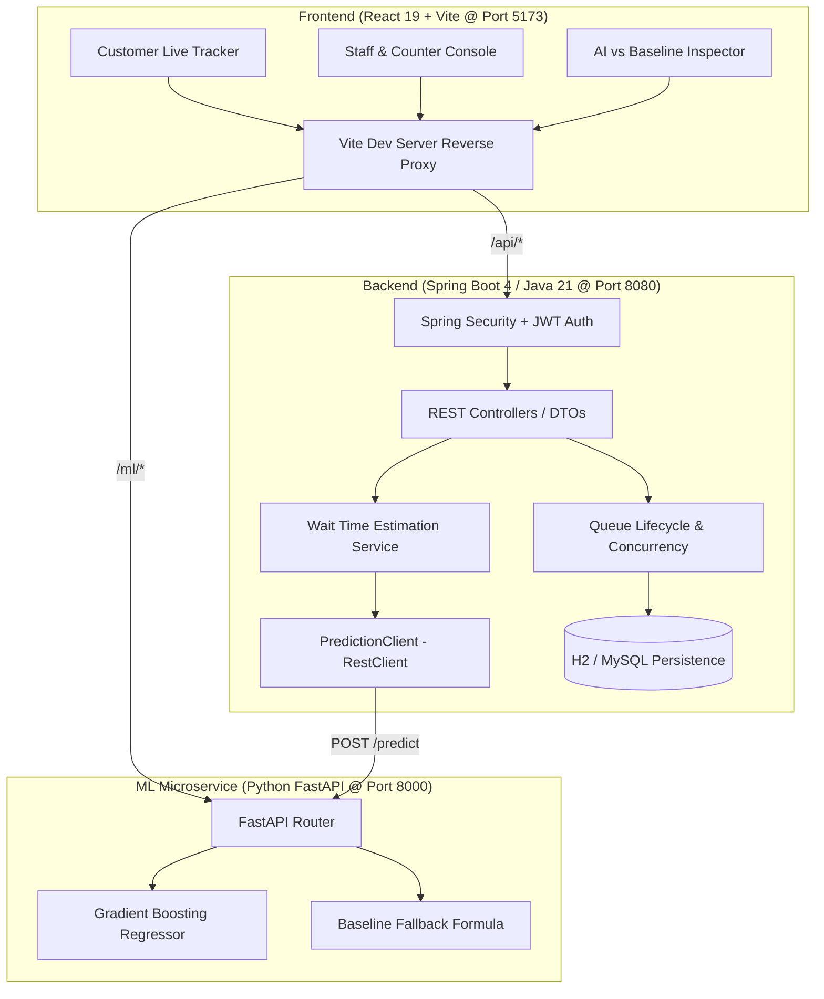

# QueueLess AI — Smart Queue Management with ML Wait-Time Prediction

Queue management platform combining a Spring Boot backend, Python FastAPI machine learning microservice for dynamic wait-time estimation, and a React frontend.

---

## Architecture



---

## Key Features

1. **Sequential Token Generation & Concurrency Control**
   - High-throughput queue management with tokens like `T-001`, `T-002`, `T-003`.
   - Concurrency-safe atomic token counter and status transitions (`WAITING` ➔ `CALLED` ➔ `IN_SERVICE` ➔ `COMPLETED` / `SKIPPED`).
2. **AI-Powered Wait-Time Estimation**
   - Trained on 10,000 synthetic queue records using 5-fold cross validation.
   - **65.4% Error Reduction** compared to deterministic baseline ($MAE: 18.89\text{m} \rightarrow 6.53\text{m}$, $R^2 = 0.9875$).
   - Dynamically accounts for peak rush hours (11:00–14:00, 17:00–19:00), day of week congestion, counter count, and procedure complexity.
3. **Resilient Circuit-Breaker Fallback**
   - Zero-downtime architecture: if the Python ML microservice is unreachable, the Spring Boot `PredictionClient` automatically degrades to deterministic queue mathematics ($\lceil \frac{\text{peopleAhead} \times \text{duration}}{\text{activeCounters}} \rceil$).
4. **Role-Based Access Control (RBAC)**
   - Stateless JWT tokens with BCrypt password hashing.
   - Roles: `ROLE_CUSTOMER`, `ROLE_STAFF`, `ROLE_BUSINESS_OWNER`.
   - Customers can only manage their own entries; staff and owners control counters and queue operations.
5. **Interactive AI vs. Baseline Inspector**
   - Real-time interactive sandbox comparing AI predictions with baseline formulas.
   - Live feature attribution, rush factor adjustments, and latency telemetry.

---

## Technology Stack

| Layer | Technologies |
|---|---|
| **Frontend** | React 19, Vite, Lucide Icons, Vanilla CSS (Glassmorphism design tokens) |
| **Backend** | Java 21, Spring Boot 4.0.0, Spring Security 6, Spring Data JPA, JJWT 0.12.6, H2 / MySQL |
| **ML Engine** | Python 3.12+, FastAPI, scikit-learn, joblib, numpy, pandas, pydantic |
| **Testing** | JUnit 5, Mockito, pytest, PowerShell End-to-End Integration Suite |

---

## Quickstart Guide

### 1. Start Python ML Microservice
```powershell
cd ml-service
python -m pip install -r requirements.txt
python -m uvicorn app.main:app --host 127.0.0.1 --port 8000
```
- Endpoint: `http://127.0.0.1:8000`
- Swagger UI docs: `http://127.0.0.1:8000/docs`
- Health check: `http://127.0.0.1:8000/health`

### 2. Start Spring Boot Backend
```powershell
cd backend
.\mvnw spring-boot:run
```
- Endpoint: `http://localhost:8080`
- Configured to communicate with ML service at `http://127.0.0.1:8000`

### 3. Start Frontend Dev Server
```powershell
cd frontend
npm install
npm run dev -- --host
```
- Open browser at `http://localhost:5173`
- Reverse proxy maps `/api` ➔ `http://localhost:8080` and `/ml` ➔ `http://127.0.0.1:8000`

---

## ML Model Performance & Attribution

The Gradient Boosting Regressor is trained on realistic queuing friction factors:
- **Baseline MAE:** 18.89 minutes
- **ML Model MAE:** 6.53 minutes (**+65.4% improvement**)
- **Goodness-of-fit ($R^2$):** 0.9875
- **Peak Hour Gain:** +76.9% accuracy boost during rush periods

### Feature Attribution:
| Feature | Attribution |
|---|---|
| Deterministic Baseline Estimate ($\lceil \frac{P \times D}{C} \rceil$) | **96.88%** |
| Peak Hour Indicator (11–13h, 17–18h) | **1.23%** |
| People Ahead Waiting Backlog | **0.52%** |
| Service Complexity Category | **0.27%** |
| Day of Week Congestion | **0.24%** |

---

## REST API Reference

### Authentication
- `POST /api/auth/register` — Register a Customer, Staff, or Business Owner.
- `POST /api/auth/login` — Authenticate and receive signed JWT.
- `GET /api/auth/me` — Retrieve current authenticated user profile.

### Business & Services
- `POST /api/businesses` — Create a new business (Owner only).
- `GET /api/businesses/{id}` — Retrieve business profile.
- `POST /api/businesses/{id}/services` — Register a service offering with estimated duration.
- `GET /api/businesses/{id}/services` — List all services for a business.

### Queue Management
- `POST /api/services/{id}/queues` — Open a daily queue with specified active counters.
- `GET /api/queues/{id}` — Get queue status and summary.
- `PUT /api/queues/{id}/close` — Close queue (rejects subsequent join requests).

### Customer Queue Flow
- `POST /api/queues/{id}/entries` — Customer joins queue (returns `tokenNumber`, e.g. `T-001`).
- `GET /api/queues/{id}/entries/my` — Get current customer's position and people ahead.
- `PUT /api/queue-entries/{id}/cancel` — Customer voluntarily cancels their queue spot.
- `GET /api/queue-entries/{id}/estimate` — Compute live wait time (calls ML or baseline fallback).

### Staff & Counter Operations
- `GET /api/queues/{id}/entries` — List all waiting, called, and active queue entries.
- `PUT /api/queues/{id}/entries/call-next` — Advance queue and call next waiting customer (`CALLED`).
- `PUT /api/queue-entries/{id}/start-service` — Mark service begun at counter (`IN_SERVICE`).
- `PUT /api/queue-entries/{id}/complete` — Mark customer service finished (`COMPLETED`).
- `PUT /api/queue-entries/{id}/skip` — Mark customer as skipped no-show (`SKIPPED`).

### Python ML Microservice
- `GET /health` — Service status and loaded model metadata.
- `GET /model-info` — Detailed metrics, training timestamp, and feature importances.
- `POST /predict` — Wait-time inference payload `{ people_ahead, active_counters, service_duration_min, hour_of_day, day_of_week, service_category }`.

---

## Automated Test Suites

### Run Backend Unit & Integration Tests:
```powershell
cd backend
.\mvnw test
```
*(All 13 tests pass)*

### Run Python ML Microservice Tests:
```powershell
cd ml-service
python -m pytest -v
```
*(All 7 tests pass)*

### Run Production Frontend Build:
```powershell
cd frontend
npm run build
```
*(Zero compilation errors, optimized bundles generated)*

### Run Full End-to-End System Test:
```powershell
powershell -ExecutionPolicy Bypass -File .\scratch\test_e2e_full_lifecycle.ps1
```
*(Validates complete owner, customer, staff, queue, estimate, and ML lifecycle across all 3 services)*

---

## License
Created as part of the **QueueLess AI** Initiative. Built with Spring Boot, Python, and React.
